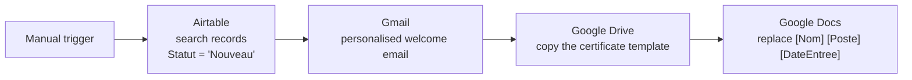
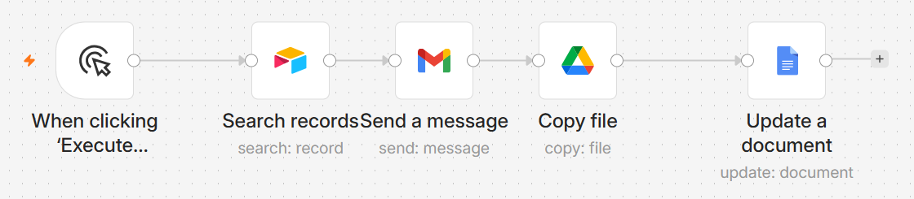
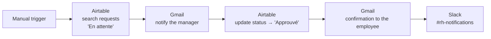
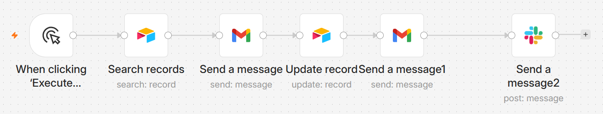

# 🤖 HR & Administrative Workflow Automation with n8n

Internship project at **Job Gate** (1 month): automate repetitive HR and administrative tasks with **n8n** workflows connected to Airtable, Gmail, Google Drive / Docs and Slack.

Two working workflows cover the five goals of the internship: HR automation, document generation, automatic notifications, approval workflow and cloud tool integration.


---

## 🔄 Workflow 1 — Employee onboarding (`Onboarding Employés`)



Every new employee automatically receives a welcome email, and a **work certificate** (attestation de travail) is generated from a Google Docs template.



## 🔄 Workflow 2 — Leave request approval (`Validation Congés`)





---

## 🗂️ Airtable base — table `Employés`

| Field | Type |
|---|---|
| Nom | Single line text |
| Email | Email |
| Poste | Single line text |
| Date d'entrée | Date |
| Statut | Single select (Actif, Inactif, En congé, Nouveau) |
| Demande congé | Single select (En attente / Approuvé / Refusé) |

---

## 🚀 Run it locally

```bash
docker compose up -d
```

1. Open http://localhost:5678 and create the owner account.
2. Import the workflows from `workflows/` (**…** menu → *Import from File*).
3. Create your own credentials in n8n: Airtable token, Google OAuth2 (Gmail, Drive, Docs), Slack bot token (`chat:write`, `channels:read`).
4. Create the Airtable table above and a Google Docs template containing `[Nom]`, `[Poste]` and `[DateEntree]`.

> Credentials are **not** included: exported workflows only reference credential names. Airtable IDs, the Google Docs template ID and email addresses were replaced by placeholders (`YOUR_AIRTABLE_BASE_ID`, `YOUR_TEMPLATE_DOC_ID`, `manager@example.com`) — set your own after import.

---

## 🧩 Problems I solved

| Problem | Solution |
|---|---|
| Google Cloud required MFA before creating OAuth credentials | Enabled 2-step verification on the Google account |
| Gmail node returned "API not enabled" | Enabled the Gmail API in the Google Cloud project |
| OAuth consent blocked the login | Added my account as a **test user** of the OAuth app |
| `invalid client secret` error | Regenerated the client secret and updated the n8n credential |
| Template variables `{{ }}` clashed with n8n expressions | Used square brackets `[Nom]` in the Google Docs template |

---

## 🗺️ Next improvements
- Replace the manual trigger with a Schedule or Airtable trigger so workflows run automatically.
- Add a real approval step (Slack buttons or a form) instead of approving every pending request automatically.
- Send the Slack notification when the request arrives (today it is sent after approval, with an "awaiting validation" message).
- Error handling: an error workflow that alerts HR on Slack when a node fails.

## 📁 Repository structure

```
.
├── docker-compose.yml
├── workflows/
│   ├── onboarding.json
│   └── leave-approval.json
└── docs/screenshots/         # workflow screenshots
```

**Author:** Amira Salah — Cloud Computing & Networks engineering student · [GitHub](https://github.com/amirasalah01)
